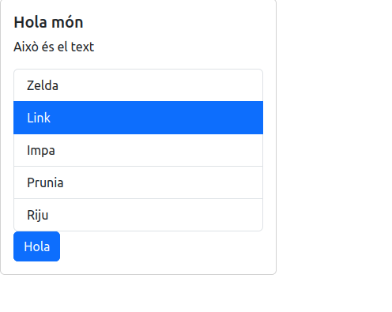
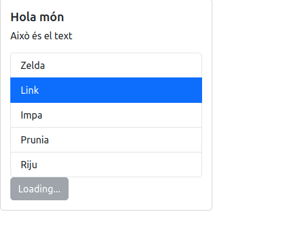

# Guia breu de React

## 1. Objectiu

En aquesta pràctica introduïm React pas a pas, construint una aplicació petita i seguint-ne l’evolució amb Git. El repositori de l’exemple és [`my-first-app/`](my-first-app/).

La guia està en desenvolupament i s’anirà ampliant a mesura que avancem a classe. De moment, l’exemple arriba fins al pas de múltiples propietats (*props*). Els passos següents previstos són `children`, una llista, esdeveniments i estat. El botó amb canvi d’estat serà un exercici per fer a classe, no una part de l’exemple guiat.

## 2. Què és React?

React és una biblioteca JavaScript per construir interfícies d’usuari amb components. Els components permeten dividir la interfície en peces petites i reutilitzables. Més endavant farem servir props per passar informació entre components, i estat per representar dades que poden canviar mentre s’utilitza l’aplicació.

## 3. Crear i executar el projecte

Per crear un projecte nou amb Vite, executa:

```bash
npm create vite@latest my-first-app -- --template react
cd my-first-app
npm install
npm run dev
```

Durant la creació, si Vite pregunta quin *linter* volem fer servir, seleccionem **ESLint**. Si pregunta si volem afegir **Vite DevTools**, seleccionem que **no**: per a aquesta pràctica farem servir ESLint i no necessitem Vite DevTools.

### Instal·lar Bootstrap

Un cop creat el projecte, des de la carpeta `my-first-app/`, instal·lem la darrera versió estable de Bootstrap amb npm:

```bash
npm i bootstrap@latest
```

Després importem el CSS de Bootstrap a `src/main.jsx`, abans de renderitzar l’aplicació. Així les classes de Bootstrap queden disponibles als components:

```jsx
import 'bootstrap/dist/css/bootstrap.min.css'
```

La línia es pot veure al [punt d’entrada del projecte](my-first-app/src/main.jsx). Per als components que necessitin interactivitat pròpia de Bootstrap, caldrà importar també el JavaScript corresponent; en aquesta pràctica fem servir les classes CSS.

Si el projecte ja està clonat, no cal tornar-lo a crear. Des de la carpeta `my-first-app/`, executa:

```bash
npm install
npm run dev
```

Vite mostrarà l’adreça local on es pot obrir l’aplicació. Per aturar el servidor, prem `Ctrl+C` al terminal.

Fitxers principals:

- `package.json`: dependències i ordres del projecte.
- `index.html`: document HTML inicial, amb el punt d’entrada de l’aplicació.
- `src/main.jsx`: crea l’arrel de React i renderitza `App`.
- `src/App.jsx`: component principal de l’aplicació.
- `src/components/`: components que hem anat extraient de l’aplicació.

## 4. Recorregut fet a classe

Els commits permeten consultar el projecte tal com era a cada pas. Des de `my-first-app/`, fes servir `git log --oneline` per veure l’historial. Per obrir un pas concret:

```bash
git switch --detach <hash-del-commit>
```

Per tornar a la branca principal:

```bash
git switch main
```

| Pas | Commit actual | Què s’hi treballa |
| --- | --- | --- |
| 1 | `3c2753f` — Projecte React inicial | Crear l’aplicació amb Vite i reconèixer l’estructura inicial. |
| 2 | `9dd288b` — App net | Treure el contingut de demostració de la plantilla i començar amb una aplicació mínima. |
| 3 | `573d153` — Eliminació d’estils i instal·lació bootstrap | Simplificar els estils inicials i afegir Bootstrap. |
| 4 | `0f17369` — Rendiritzat dinàmic | Generar contingut a partir de dades. |
| 5 | `a8fab68` — Components: Card | Extreure una part de la interfície en un component `Card`. |
| 6 | `280cbe3` — Card amb fragments | Crear `CardBody` i retornar diversos elements amb un fragment. |
| 7 | `1aca39e` — Props | Passar dades a un component mitjançant propietats. |
| 8 | `7d2042a` — Multiples props | Passar diverses propietats, com ara `title`, `subtitle` i `text`. |

Els noms de la taula són els missatges actuals dels commits. També es pot canviar el missatge d’un commit des de VS Code amb l’eina **Git Graph**, tal com hem vist a classe: obre el gràfic, selecciona el commit i fes servir l’opció d’editar-ne el missatge. Si el commit ja s’ha compartit al repositori remot, el canvi reescriu l’historial i caldrà actualitzar el remot; per això és preferible acordar missatges clars abans de compartir-los. Per als commits nous, farem servir missatges breus i descriptius, per exemple `Afegir component Card` o `Passar diverses props a CardBody`.

## 5. Conceptes treballats fins ara

### Components

Un component és una funció que retorna JSX. En aquest exemple, `App` utilitza `Card`, i `Card` utilitza `CardBody`.

### JSX i fragments

JSX permet descriure la interfície amb una sintaxi semblant a HTML dins de JavaScript. Un component ha de retornar un únic element arrel; els fragments (`<>...</>`) agrupen elements sense afegir un node extra al document.

### Props

Les props són les dades que el component pare passa al component fill. A l’exemple, `CardBody` rep `title`, `subtitle` i `text`. També es poden desempaquetar directament al paràmetre:

```jsx
function CardBody({ title, subtitle, text }) {
  return (
    <>
      <h5>{title}</h5>
      <h6>{subtitle}</h6>
      <p>{text}</p>
    </>
  );
}
```

## 6. Continguts previstos

Afegirem aquesta secció a mesura que es desenvolupin els passos corresponents a classe:

1. **`children`**: posar contingut entre l’etiqueta d’obertura i la de tancament d’un component i llegir-lo des de `props.children`.
2. **Llistes**: renderitzar una col·lecció de dades i assignar una `key` estable a cada element.
3. **Esdeveniments**: respondre a accions de l’usuari, per exemple amb `onClick` i una funció manejadora.
4. **Estat**: utilitzar `useState` per conservar dades que canvien i actualitzar la interfície quan canvien.
5. **Exercici del botó**: aplicar esdeveniments i estat per reproduir les dues captures següents. Aquest exercici es completarà per separat de l’exemple guiat.

### Exercici: canviar l’estat d’un botó

Construeix una targeta amb Bootstrap que mostri el mateix resultat que les captures. La interfície té un títol (`Hola món`), un text (`Això és el text`), una llista amb `Zelda`, `Link`, `Impa`, `Prunia` i `Riju` (amb `Link` seleccionat), i un botó.



Quan es prem el botó, ha de canviar a l’estat que es veu a la segona captura:



**Requisits:**

- El botó comença habilitat, de color blau i amb el text `Hola`.
- En fer-hi clic, el text passa a ser `Loading...` i el botó queda desactivat i gris.
- El canvi s’ha de fer amb estat de React (`useState`) i un manejador d’esdeveniment (`onClick`); no s’ha de modificar el DOM directament.
- La targeta, el text i la llista han de continuar visibles després del clic.

**Pistes:** importa `useState` de React; guarda a l’estat si s’ha premut el botó; fes servir aquesta dada per decidir-ne el text i l’atribut `disabled`. A Bootstrap, la llista es pot construir amb `list-group` i `list-group-item`, i l’element seleccionat amb `active`.

## 7. Referències

- [Documentació oficial de React](https://react.dev/learn)
- [Referència de `useState`](https://react.dev/reference/react/useState)
- [Documentació de Vite](https://vite.dev/guide/)
- [Documentació oficial d’instal·lació de Bootstrap](https://getbootstrap.com/docs/5.3/getting-started/download/)
